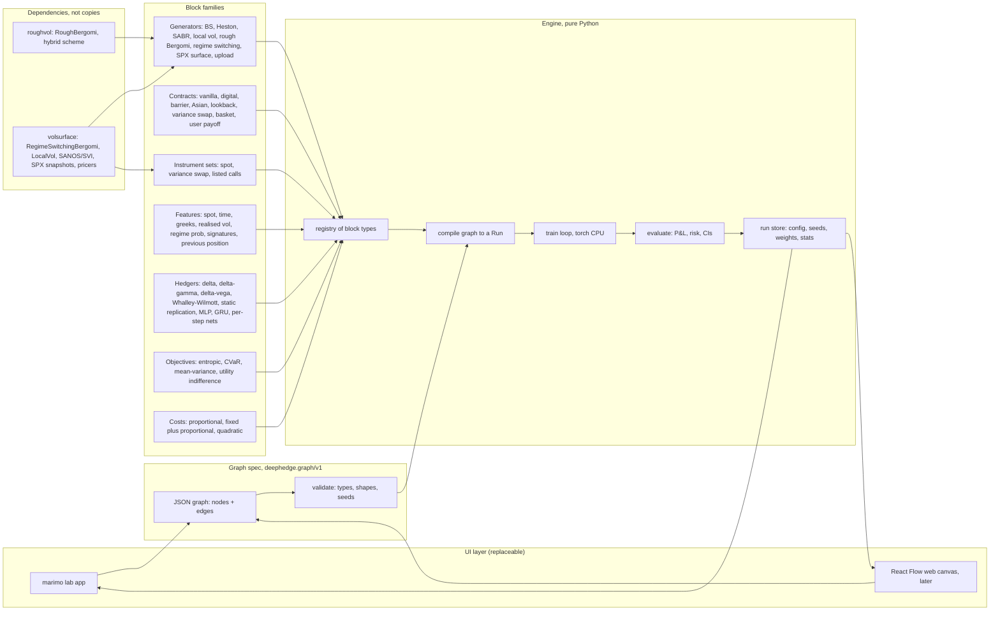

# deep-hedging: plan for the hedging lab

Status: planning document, no code. Written on branch `plan/fable-v1` on 21 October 2026.
Detailed module cards, interface signatures, the maths and the regime experiment are in
`docs/plan/`. This file is the summary and the decisions; the owner's answers to the planning
questions are recorded in section 10 (decisions, owner, 2026-10-21).

Note on tooling: Fable (the planning model used to write this document) is disabled for
this repository once this PR merges. Cursor cloud agents build the modules, Claude Opus
reviews, Grok Bot orchestrates.

## 1. What the repository becomes

A personal research project in mathematical finance: an interactive hedging lab in which
a user picks a market generator, a contract and a hedger, runs or trains it, and compares
hedgers side by side on honest out-of-sample and cross-environment tests. Research tool
first, demo second. Every run is reproducible from a saved JSON graph specification plus
seeds.

Today `main` holds session 00 (a Black-Scholes deep hedger with proportional costs) and
five stacked draft PRs (market environment, cost models, Whalley-Wilmott band, marimo
playground, live view). The plan keeps the good parts of those PRs and replaces the
one-off `Setup` / `HestonSetup` / `PlaygroundSpec` configuration objects with one typed
graph spec.

## 2. UI decision: option C, hybrid

**Recommendation: option C.** A typed JSON graph spec (`deephedge.graph/v1`) is the
single source of truth; a Python engine compiles and runs it; the first UI is marimo
(extending the PR 4 playground); a React Flow web canvas over a FastAPI job runner is a
later, optional module that reads and writes the same spec. Owner decision (D1): marimo
stays the first UI, and M20 is deferred until M10 (the evaluator) has landed; it is then
reconsidered only if the marimo lab feels limiting.

Why not A alone (extend marimo): marimo has no node canvas, and PR 4 already found that a
true drag-and-drop board means a JavaScript widget. Marimo is right for the first year
(the author can read every line, it runs on the modest server, `marimo export html`
gives a static demo) but it would couple the lab to one UI if the engine were written
around it.

Why not B now (React Flow plus FastAPI): a second toolchain (node, bundler, TypeScript),
a job queue for training runs, and a static site that cannot train in the browser (torch
does not run in Pyodide, as PR 4 notes). For one person in spare time this is the most
expensive path and it delays the research. It is the best demo, so it stays as a later
module once the spec is stable.

Trade-offs accepted with C: the marimo "drag and drop" is lists, radio cards and file
drops rather than a canvas; a few UI-only conveniences (spec editing, run history) are
written twice if the web UI ever lands. The gain is that the engine never imports a UI,
every experiment is a JSON file, and the pre-registered regime experiment runs headless
from the same engine.

## 3. Architecture and data flow



Data flow of one run:

1. The UI (or a script, or the experiment runner) writes a graph spec: a market node, a
   contract node, an instrument-set node, zero or more feature nodes, one hedger node per
   hedger to compare, one objective node, one cost node, one evaluator node, plus seeds.
2. `validate` checks every edge: feature dimension against policy input, instrument count
   against policy output, contract against the instruments it needs, that the generator
   exposes the state a feature asks for, that every seed is set. It fails before any path
   is simulated.
3. `compile` turns the spec into a `Run`: a generator, an `Environment` (generator plus
   cost), a payoff functional, a list of policies, an objective, an evaluator.
4. Paths are simulated once per (generator, seed, split) and cached on disk. Train,
   validation and test are three seeds, never the same paths.
5. Learned hedgers train on the train split with the objective; classical hedgers need no
   training. All are rolled out on the test split through one P&L function.
6. The evaluator writes `runs/<spec_id>/`: the spec, the resolved config, seeds, weights,
   per-path P&L, statistics with bootstrap intervals, and a short markdown report.

The shared, typed interface (details in `docs/plan/01-interfaces.md`):

- `Generator.simulate(m, n, seed) -> Paths` with `instruments (m, n+1, d)`,
  `features (m, n+1, f)`, `state` (named arrays such as variance, regime probability,
  forward variance), `time (n+1,)`, `discount`.
- `Contract.payoff(paths) -> (m,)` (numpy and torch), plus `monitoring` metadata so the
  validator can check the grid.
- `Pricer.price_along(paths, contract) -> (m, n+1)` and `Pricer.greeks(...)`, optional
  per generator, with a Monte Carlo fallback that reports its standard error.
- `Policy(t, features (m, f), prev (m, d), state) -> (positions (m, d), state)`; the
  classical hedgers implement the same call so one rollout serves all.
- `Objective(pnl (m,)) -> scalar` in numpy and torch.
- `Evaluator(pnls: dict[name, (m,)], positions, paths) -> Report`.

## 4. Key maths and methods (summary; full statements in `docs/plan/03-maths.md`)

- Objective: minimise over the policy a convex risk measure `rho` of the hedged P&L
  `X = p - Z + sum_k delta_k . (S_{k+1} - S_k) - C(delta)` in time-0 money, following
  Buehler, Gonon, Teichmann and Wood (2019). The indifference price is
  `p* = rho(-Z + gains - costs)` at the optimum, computed as an output, not an input.
- Risk measures as optimised certainty equivalents: entropic (closed form via logsumexp),
  CVaR via Rockafellar and Uryasev with the threshold as a trainable scalar, mean-variance
  as a reported objective (not coherent, flagged as such), exponential-utility
  indifference as the entropic special case. Every reported risk carries a standard error
  (delta method for entropic, tail-sample bootstrap for CVaR).
- Costs: proportional (exact in training), fixed plus proportional (indicator in
  evaluation, tanh surrogate in training, width recorded in the spec), quadratic impact.
  Opening and liquidating trades are charged. Fixed costs must be discounted if `r > 0`;
  this is a bug to fix in PR 2's class.
- Pricing of hedging instruments per generator: closed forms for Black-Scholes; COS and
  quadrature for Heston (PR 1); Hagan's expansion plus Monte Carlo check for SABR; Dupire
  grid and PDE or Monte Carlo for local vol; conditional Monte Carlo given the volatility
  path for rough Bergomi (`roughvol.RoughBergomi.price_with_error`); `surface_at` and the
  pricers in `volsurface.markets` for the regime model. Where no closed form exists the
  engine uses Monte Carlo with reported standard error and caches the result on the test
  paths.
- Exotic payoffs plug in as functionals of the whole `Paths` object, not of the terminal
  spot. Discrete monitoring on the hedging grid is the default; the contract declares the
  monitoring dates it needs and the validator checks them against the grid.
- Classical hedgers per generator: delta from the pricer's greeks, delta-gamma and
  delta-vega as linear solves against the instrument set's greeks at each step,
  Whalley-Wilmott from the pricer's gamma and the proportional cost rate (the formula is
  Black-Scholes asymptotics and is reported as such when applied elsewhere), and, in a
  later wave after the first release (D6), static replication of European payoffs by a
  strike grid of calls (Carr and Madan) when the instrument set includes listed calls.

## 5. Module breakdown

Twenty modules. Each is one Cursor agent PR; cards with inputs, outputs, interfaces,
tests and acceptance criteria are in `docs/plan/02-modules.md`.

| # | Module | Depends on | Builder | Reviewer |
|---|---|---|---|---|
| M00 | Merge PR 1 after review, rebase and merge PR 2, rebase and merge PR 3 | none | owner + Cursor rebases | Opus |
| M01 | Graph spec and registry (`deephedge/spec.py`, `registry.py`) | M00 | Cursor | Opus (design) |
| M02 | Generator and Pricer protocols; split `Market`; Monte Carlo fallbacks | M01 | Cursor | Opus (design) |
| M03 | Contract blocks (`deephedge/contracts.py`) | M02 | Cursor | Opus |
| M04 | Cost blocks hardened (discounting, per-instrument, surrogate widths in spec) | M01 | Cursor | script tests |
| M05 | Policy protocol with state; FeatureMLP, GRU, per-step nets; one rollout | M01 | Cursor | Opus (design) |
| M06 | Feature blocks (`deephedge/features.py`) | M02, M05 | Cursor | Opus |
| M07 | Objective blocks (`deephedge/objectives.py`) | M01 | Cursor | Opus |
| M08 | Classical hedgers as policies (`deephedge/classical.py`) | M02, M05 | Cursor | Opus |
| M09 | Engine: compile, train, run store (`deephedge/engine.py`, `runs/`) | M01 to M08 | Cursor | Opus (design) |
| M10 | Evaluator: side-by-side report, paired bootstrap, cross-environment matrix | M09 | Cursor | Opus |
| M11 | Generators: rough Bergomi (roughvol) and SABR | M02 | Cursor | script tests |
| M12 | Generators: regime-switching Bergomi (volsurface) with regime features and variance-swap instrument | M02, M06 | Cursor | Opus |
| M13 | Generators: local vol from a surface, and the calibrated SPX surface route | M02 | Cursor | Opus |
| M14 | Generators: uploads (paths CSV, block bootstrap, user `.py`), from PR 4 | M02 | Cursor | script tests |
| M15 | Marimo lab app, from PR 4 (`lab/app.py`) | M09, M10 | Cursor | owner |
| M16 | Live one-path view, from PR 5 (`lab/live.py`) | M09 | Cursor | owner |
| M17 | Sessions 00 to 03 reproduced on the engine; weights regenerated; docs | M09, M10 | Cursor | script (regression tests) |
| M18 | Pre-registered regime experiment runner (`experiments/regime/`) | M10, M12 | Cursor | Opus (gate logic) |
| M19 | Paper SPX hedger from daily IBKR snapshots (no orders) | M13, M09 | Cursor | Opus |
| M20 | Web canvas (React Flow + FastAPI), deferred (D1): reconsidered after M10 lands | M09, M10 | Cursor | owner |

Module count: 21 entries including M00; 20 build modules.

### Dependency order and parallelism

```
M00
 +-- M01 --+- M02 --+- M03
          |        +-- M11 -+
          |        +-- M13  |
          |        +-- M14  |
          +-- M04           |
          +-- M05 --+- M06 -+- M12
          |        +-- M08  |
          +-- M07           |
                 M09 (needs M01 to M08) -- M10 --+- M15 -- M16
                                                +-- M17
                                                +-- M18 (needs M12)
                                                +-- M19 (needs M13)
                                                +-- M20
```

Waves (max three Cursor agents at once, so reviews keep up):

1. M00, then M01 alone (everything imports it).
2. M02, M04, M05, M07 in parallel (four, but M04 and M07 are small).
3. M03, M06, M08, M11, M14 in parallel (pick three at a time).
4. M09 alone (integration), then M10.
5. M12, M13, M15, M17 in parallel.
6. M16, M18, M19.
7. M20 is deferred (D1). Once M10 has landed, the owner decides whether the marimo lab
   feels limiting; only then does M20 start, and only on a spec that has been stable for a
   month.

## 6. The five draft PRs

Full reasoning in `docs/plan/05-existing-prs.md`.

| PR | Recommendation |
|---|---|
| #1 Shared market environment, Heston, session 01 | **Merge after review** (rebase on main). It is the base of the stack and its `Market`, `Paths`, `Environment`, `terminal_pnl` are what M02 generalises. Known debts carried into M02: call-only pricing, `price_along` and `benchmark_positions` mandatory, no torch method on `Environment`. |
| #2 Pluggable costs, export schema, session 02 | **Rebase and merge** once #1 is in. `costs.py` becomes M04's starting point. `export.py`'s `deephedge.hedge/v1` is a starting point, not a frozen schema (D3): M09 may replace it with its own run-store layout. Fix later in M04: fixed cost not discounted; `unit` for the variance swap documented as a notional. |
| #3 Whalley-Wilmott band, session 03 | **Rebase and merge** once #2 is in: it is a finished session with a logged result (the fitted exponent 0.293 at 120 steps). `band.py` is then folded into M08 as a policy that takes gamma from any pricer; the Black-Scholes-only functions stay as the reference implementation in tests. |
| #4 Marimo playground, uploads, bootstrap, GRU | **Do not merge as is; fold.** `upload.py`, `bootstrap.py`, `merton_jump.py` go to M14; `GRUPolicy` and `reset_state` go to M05; `PlaygroundSpec` is replaced by the graph spec (M01) and `run_experiment` by the engine (M09); `playground/app.py` is rewritten as M15 over the spec. Stays open as a draft until M14 and M15 absorb it (D2); only then close it, crediting it in LOG.md. |
| #5 Live view and LEARN.md | **Fold.** `live.ledger` and `Book` become the step-by-step accounting in M16, generalised to any policy, cost model and instrument set via the engine; `LEARN.md` can merge on its own as a docs-only PR (it references exercise files that do not exist; mark them as planned). Stays open as a draft until M16 absorbs it (D2); only then close it, crediting it in LOG.md. |

Order of operations: merge #1, #2, #3 in sequence (each is stacked on the previous), then
open M01. #4 and #5 stay open as drafts until M14 to M16 absorb them (D2). Do not merge
#4 or #5 onto main: their engine code would be rewritten within
weeks and their weights and PNGs add 20 binary files.

## 7. Model and tool assignment, with a token-cost note

- **Cursor cloud agents** build every module from M01 onward. Each brief is the module
  card from `docs/plan/02-modules.md` plus the interface file. Cost: outside the Claude
  allowance.
- **Claude Opus** reviews the design modules (M01, M02, M05, M09) before the first commit
  and reviews every PR diff. Rough cost per review: 60k to 150k input tokens for a
  2,000-line diff plus a few thousand output. Twenty modules, say 25 reviews, roughly
  2.5M input tokens over the project. Keep reviews to the diff and the module card; do
  not have Opus read the whole repository each time.
- **Plain scripts** (no model) regenerate weights, figures and the regression tables
  (M17), run `ruff` and `pytest`, and run the regime experiment (M18). A CI job on each
  PR runs `pytest -m "not slow"`; the slow suite runs nightly or on demand.
- **Sonnet-class workers** are enough for diff summaries, changelog entries and
  formatting; never use Opus for those.
- **Fable** wrote this plan and is disabled for this repository after it merges.

## 8. The pre-registered regime experiment on this engine

Full mapping in `docs/plan/04-regime-experiment.md`. In short:

- Generator node: `regime_bergomi` wrapping `volsurface.markets.RegimeSwitchingBergomi`
  with `RegimeSpec(Q = [[-1.5, 1.5], [0.8, -0.8]], nu = (1.5, 3.0), p0 = (0.7, 0.3))`,
  `H = 0.1`, `rho = -0.4`, `xi0 = 0.04`, `price_filter = "rv"`. The engine accepts the
  volsurface `MarketPaths` directly, passed through in `Paths.source`, so the surface
  batches for H3 are kept (D4). Seeds come from
  `volsurface.markets.run_seed(entropy, split)`, never from the engine's own seeding.
- Contract nodes: `L1` (ATM call, 21 trading days from the episode start at t0 = 0.5)
  and `L2` (forward-start ATM straddle, 15 days forward, 30 days life).
- Instrument-set nodes: `I1` (spot), `I2` (spot plus 21-day variance swap marked by
  `VarianceSwapPricer` plus the realised leg), `I3` (spot plus an ATM call from
  `SurrogatePricer`, only if its validation error clears the PREREG bar).
- Feature nodes: time, log moneyness, previous position, and one of {nothing, windowed
  realised-variance Hamilton filter probability, latent regime} to make
  `pi_L, pi_H, pi_mix, pi_filt, pi_oracle`.
- Objective: entropic at `lambda = 0.1` on P&L divided by the liability's time-0 premium
  (premium from 65,536 Monte Carlo paths at `run_seed(1, 0)`, fixed).
- Evaluator: `Gap(X -> Y)` contrasts with the hierarchical paired percentile bootstrap
  (seeds first, then paths, B = 10,000), one-sided lower bound at level `1 - 0.05/3` for
  the H1 to H3 family; H4 and H5 are exploratory reports. Negative and positive controls
  are extra graph specs that differ only in the generator parameters.
- Sample sizes: 100k train, 20k validation, 20k test paths; 5 network seeds, rule to go
  to 10. At 126 plus 21 daily steps on CPU this is the one experiment that will not run
  in minutes; the plan budgets hours and caches paths on disk.

## 9. Risks

- **Scope.** Twenty modules for one person in spare time. Mitigation: waves 1 to 4 are
  the product; waves 5 to 7 are optional and independently valuable.
- **Dependency drift.** `volsurface` and `roughvol` are moving targets (the PREREG is
  not frozen; `roughvol` is pinned by git sha in volsurface). Mitigation: pin both by
  tag or sha in `pyproject.toml` optional extras `[regime]` and `[rough]`; adapter tests
  that fail loudly on API change.
- **Monte Carlo pricing cost.** Greeks for rough Bergomi and regime models along 20k
  paths are expensive. Mitigation: classical hedgers on those generators use cached
  pricers or surrogates; the plan reports standard errors and allows delta at
  `sqrt(v_t)` as the cheap benchmark, as PREREG does.
- **Honesty of comparisons.** Train and test on the same paths, or tuning a fixed band
  on the test seed, would inflate results. Mitigation: three named seeds per run in the
  spec, validator refuses a spec where any two coincide, the evaluator reports the
  split used.
- **Fixed-cost training.** The tanh surrogate saturates (PR 2). Mitigation: width is a
  spec field, recorded; evaluation is always exact.
- **Uploaded `.py` markets execute arbitrary code.** Local use only; the web UI (M20)
  must not accept them without a sandbox.
- **Weights in git.** PRs already add dozens of `.pt` files. Mitigation: M09's run store
  writes under `runs/` (git-ignored) and only the session caches needed for the static
  docs are committed, regenerated by script.
- **SPX paper hedger.** The daily IBKR snapshot job stays outside this repository (D8);
  M19 only reads recorded snapshots, is last, and must never place an order.

## 10. Decisions (owner, 2026-10-21)

The planning questions were answered by the owner on 21 October 2026. Each answer is a
decision, cited as D1 to D10 where the plan depends on it.

1. **D1 UI.** Marimo stays the first UI. M20 (React Flow plus FastAPI canvas) is deferred
   until M10 (the evaluator) has landed, and is then reconsidered only if the marimo lab
   feels limiting.
2. **D2 PRs 4 and 5.** Both stay open as drafts until M14 to M16 absorb them. Each is
   closed with a LOG.md credit only then.
3. **D3 Export schema.** The `deephedge.hedge/v1` schema from PR 2 is not frozen; M09 may
   replace it with its own run-store layout.
4. **D4 Regime experiment input.** The engine accepts volsurface's `MarketPaths` directly
   (pass-through in `Paths.source`), keeping the surface batches for H3.
5. **D5 Hurst preset.** The rough Bergomi default preset is `H = 0.1`, matching the
   PREREG, exposed as an adjustable parameter. The empirical reference is the author's
   own estimates in the rough-volatility repo: H about 0.148 on Oxford-Man rv5 (SE about
   0.013) and about 0.167 on SPX (0.115 to 0.207 across windows). An earlier draft of
   this plan said 0.07 was closer to realised-variance estimates; that was wrong. The
   session 05 sweep over H brackets these values.
6. **D6 Static replication.** The Carr-Madan static replication block is a later-wave
   item, not part of the first release.
7. **D7 Signature features.** M06 implements truncated level-2 and level-3 signatures by
   hand; no `iisignature` or `signatory` dependency.
8. **D8 SPX data.** The committed `SPX_2026-10-14.parquet` snapshot in volsurface is the
   lab's default. The daily IBKR snapshot job stays where it is, outside this repository.
9. **D9 Run-time budget.** Accepted: a default lab run finishes in under two minutes
   (2,000 paths, 20 epochs, four cores); committed session caches regenerate in under
   five minutes.
10. **D10 Exercises.** `exercises/` and the `--impl` test switch are kept, re-keyed to the
    new module names (M17).

## 11. Definition of done

The lab is done when all of the following hold on `main`:

- A JSON graph spec round-trips through `validate` and `compile`, and the same spec with
  the same seeds reproduces a saved run's statistics to the printed digits.
- Every generator in section 3 is available as a node, each with a martingale test, a
  shape test and a seed-determinism test; rough Bergomi and regime switching import from
  `roughvol` and `volsurface` with pinned versions.
- Every contract in section 3 is a node with a payoff test against a closed form or an
  independent Monte Carlo at 4 standard errors.
- Every hedger (classical and learned) goes through one rollout and one P&L function;
  session 00's table is reproduced from the engine.
- The evaluator produces a side-by-side report with standard errors or bootstrap
  intervals for every number, and a cross-environment matrix for at least two generators
  and two hedgers.
- The marimo lab app builds a spec from its widgets, runs it, and shows the comparison;
  `marimo export html` produces a static demo.
- The regime experiment runner executes H1 to H3 end to end on a reduced sample (1k
  paths, 1 seed) in CI and the full sample on demand, writing the gate verdict in the
  PREREG's own vocabulary.
- A default lab run (2,000 paths, 20 epochs, four cores) finishes in under two minutes
  and every committed session cache regenerates in under five minutes (D9).
- `exercises/` and the `--impl exercises` test switch still work, re-keyed to the new
  module names (D10).
- `ruff check` is clean, `pytest -m "not slow"` passes in under two minutes, and the
  README describes the lab in one screen.
