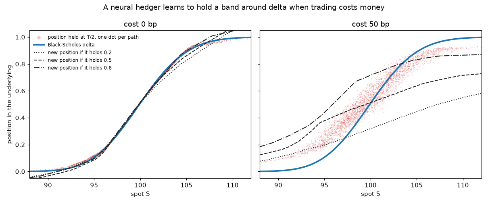
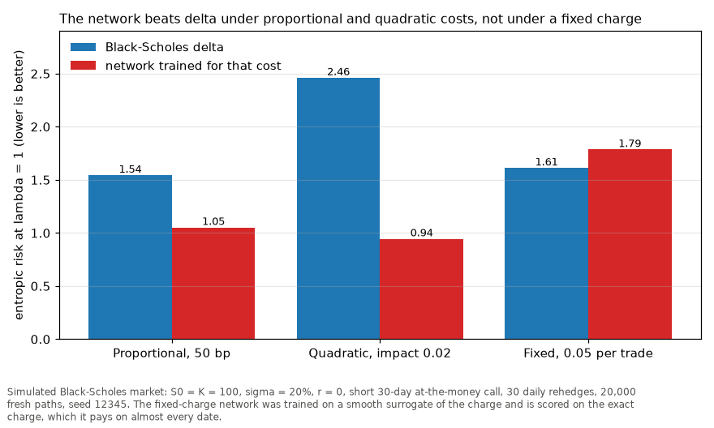

# deep-hedging

**With 50 bp trading costs, a trained hedger cuts entropic risk from 1.54 to 1.05 against
Black-Scholes delta, and loses 0.83 on average instead of 1.37 on a 2.29 premium (20,000
simulated paths). At 200 bp it beats the Whalley-Wilmott asymptotic band, 3.35 against
4.37 (delta 6.83).**

A neural network is trained end to end on simulated paths to minimise a convex risk
measure of the hedged P&L of a short call, as in Buehler, Gonon, Teichmann and Wood (2019),
and compared with delta hedging and with no-trade bands. The aim is deep hedging under
rough volatility; the markets so far are Black-Scholes and Heston.



**How to read this.** Each dot is the network's holding after the day-15 rehedge on one
simulated Black-Scholes path, against that day's spot; the blue curve is Black-Scholes delta,
and the three black lines are the position the network chooses if it comes into day 15
holding 0.2, 0.5 or 0.8 shares. Without costs the three lines sit on delta: rebalancing is
free, so the current holding is irrelevant and the network reproduces delta (within 0.01 near
the money). With a 50 bp proportional cost every trade costs money, so the optimal policy has a
no-trade region around delta, where carrying a small hedging error is cheaper than paying to
remove it (Whalley and Wilmott 1997). The network learns this from the P&L alone: the lines
separate, so its new position depends on its current holding and it moves only partway
towards delta (at the money, moving the incoming position from 0.2 to 0.8 moves the new
position by 0.66 of that gap), and the cloud of holdings becomes a band. Time, moneyness and
current holding are enough inputs because entropic risk is time consistent, so in this
market the optimal hedge depends only on (t, S, position).

**Caveat.** The band is soft: inside it the network still trades part of the way, where a
sharp band would not trade at all, and its centre sits slightly above delta. A sharp
constant-width band scores almost the same (session 03), so this shows a band-like policy,
not the exact optimal band.

## Results

Every number below is from `python -m deephedge.figures` (seed 12345, cached weights
trained on seed 0) and is written to [`docs/results.csv`](docs/results.csv). The short
call is 30-day at the money, S0 = K = 100, sigma = 20%, r = 0, rehedged daily.

**Session 00, proportional costs.** At 50 bp the network's mean P&L is -0.83 against
-1.37 for delta, and its entropic risk at lambda = 1 is 1.05 against 1.54. At 100 bp,
going from 10 to 120 rehedges takes delta's mean P&L from -1.96 to -4.48, close to the
square-root-of-n law; the network trained at 30 steps goes from -1.26 to -1.89, and its
standard deviation falls from 1.15 to 0.63, because inside its band it does not trade.

**Session 01, Heston, no cost.** In the Heston market of Buehler et al. (2019), section
5.2, with a variance swap as the second instrument, the network matches the model hedge but does not beat it: premium plus CVaR at 50% is 2.00
against 1.99 (the paper prints 1.94). The model hedge has P&L standard deviation 0.40,
the network 0.44, and delta in the spot alone 1.56.


**How to read this.** Terminal P&L (premium minus payoff plus trading gains) of a 30-day
at-the-money call sold at the Heston price of 1.692 and rehedged 30 times at zero cost, on
20,000 paths of the Buehler et al. (2019) Heston market. Variance has its own Brownian driver,
so the spot alone cannot hedge volatility risk and the market is incomplete: the grey
spot-only delta hedge stays exposed to realised variance, typically ending ahead but losing
heavily when variance spikes (standard deviation 1.56). A variance swap as a second instrument
hedges that second risk factor and, in continuous time, completes the market, which is why
the blue model hedge collapses to standard deviation 0.40 and CVaR 0.30. The red network,
trained only on simulated P&L to minimise 50% CVaR and never given the Heston formulas or
Greeks, lands almost on top of it. Premium plus CVaR is the indifference price under that
risk measure, the smallest premium at which the hedged book carries no risk: 2.00 for the
network against 1.99 for the model hedge (Buehler et al. 2019).

**Caveat.** The bar at -4 is not a second mode: spot-only P&L below -4 is clipped into the end
bin, so that tail is longer than it looks. The network does not beat the model hedge, and both
sit above the paper's 1.94 because variance is simulated on the coarse 30-step grid; on a finer
variance grid the model hedge scores 1.934 ([LOG.md](LOG.md)).

**Session 02, other cost models.** Under a quadratic impact of 0.02 the network's entropic risk is 0.94 against 2.46 for delta. Under a fixed
charge of 0.05 per trade it is worse than delta, 1.79 against 1.61 (see Limits).



**How to read this.** Entropic risk at lambda = 1 (lower is better) for Black-Scholes delta
and for a network trained under each cost model, on the same 20,000 Black-Scholes paths with
30 daily rehedges. Proportional and quadratic costs grow continuously with trade size, so
training gets a usable gradient that says "trade less": the network learns to carry its
holding over (at the money, moving the incoming position from 0.2 to 0.8 moves the new
position by 0.66 of that gap at 50 bp and 0.57 under quadratic impact, against 0.01 with no
cost) and beats delta, by most under quadratic impact, which punishes large rebalancing trades
hardest. A fixed charge per trade is an indicator with no gradient, so it is trained on a
smooth surrogate, tanh(|trade| / 0.05), that charges almost nothing for a tiny trade. Scored
on the exact charge, each of the network's small adjustments pays the full 0.05: its position
changes on 97% of trade slots, close to delta's 99.9%, and it loses to delta.

**Caveat.** This is a failure of the training set-up, not evidence that a fixed charge rewards
no band: a smooth surrogate and a policy that never outputs an exact zero trade are the wrong
pair. The planned fix, a policy with an explicit no-trade output, is not built yet.

**Session 03, against the Whalley-Wilmott band.** Entropic risk on the same 20,000 paths:

| Rehedges, cost | Delta | Whalley-Wilmott band | Constant band (tuned) | Network |
|---|---|---|---|---|
| 120, 5 bp | 0.244 | 0.166 | 0.165 | 0.175 |
| 30, 50 bp | 1.543 | 1.141 | 1.055 | 1.052 |
| 30, 200 bp | 6.828 | 4.365 | 3.721 | 3.350 |

Standard errors are 0.002 to 0.03 (in the CSV). The network's holdings track the
Whalley-Wilmott width across spot (correlation 0.998 at 30 steps and 50 bp), but a
constant-width band scores almost as high, so this does not show a gamma-shaped band.
At the money its cloud of holdings is 0.54 of the analytic half-width. Its width scales
like cost^0.293 at 120 steps (5 to 25 bp; bootstrap SE 0.007) against the analytic 1/3,
and like cost^0.063 at 30 steps (25 to 200 bp): discrete rehedging flattens it.


**How to read this.** Entropic risk (lower is better) against proportional cost, on a log
axis, for four hedgers scored on one shared batch of 20,000 Black-Scholes paths: 120 rehedges
at 5 to 25 bp on the left, 30 rehedges at 25 to 200 bp on the right. Delta trades at every
date by amounts that do not depend on the cost, so its expected cost bill is proportional to
the rate and its risk climbs fastest (0.244 to 1.205 from 5 to 25 bp at 120 rehedges). The
bands trade only when the position drifts outside them, so they pay far less; at 5 to 25 bp
with 120 rehedges the Whalley-Wilmott band, the constant-width band (tuned on another seed)
and the network sit within 0.01 to 0.02 of each other, the two bands tied and the network a
few standard errors behind. The Whalley-Wilmott width is an asymptotic result for small costs and continuous
rehedging (Whalley and Wilmott 1997), so on the coarse 30-date grid at 100 and 200 bp it is no
longer optimal: it is too wide (half-width 0.31 against a tuned 0.16 at 200 bp) and stays
centred on delta, while the network moves its centre up by about 0.10 and wins, 3.35 against
4.37.

**Caveat.** Each network is trained on one seed, and the engine charges liquidation at
maturity, which the continuous-time band was not built for. Up to 50 bp a tuned
constant-width band matches or beats the network, so the figure does not show that the
network has learned the gamma-shaped width of the theory.

## What is in the repository

- `deephedge/env.py`, `markets.py`: the market environment (instruments, features,
  payoff, price, benchmark hedge, a pluggable cost) and the Black-Scholes simulator.
- `deephedge/heston.py`: Heston by full truncation Euler, a variance swap, the
  characteristic-function price and the model hedge.
- `deephedge/costs.py`: proportional, fixed-plus-proportional and quadratic costs.
- `deephedge/risk.py`: entropic risk and CVaR, in numpy and torch.
- `deephedge/policy.py`, `train.py`: the networks, rollouts, end-to-end training and the
  cached settings of each session.
- `deephedge/band.py`: the Whalley-Wilmott half-width, edge-trading bands and the
  summaries used in session 03.
- `deephedge/figures.py`: every PNG in `docs/` and `docs/results.csv`.
- `deephedge/export.py`: a compact JSON of paths, positions and P&L (provisional schema).
- `sessions/00` to `03`: marimo apps, with static copies in `docs/*.html`.
- `tests/`: checks against closed forms and known rates; `pytest --impl=exercises` runs
  them against from-scratch implementations in `exercises/`.

```python
from deephedge.env import BlackScholes, Environment, ProportionalCost

market = BlackScholes(s0=100, strike=100, maturity=30 / 365, sigma=0.2)
env = Environment(market, ProportionalCost(0.005))
paths = market.simulate(20_000, 30, seed=1)
pnl = env.pnl(paths, market.benchmark_positions(paths))
```

## Reproduce

With [uv](https://docs.astral.sh/uv/) and `make` (Python 3.11, torch on CPU, versions in
`uv.lock`):

```bash
make reproduce    # uv sync, tests, then every figure and docs/results.csv (about 1.5 minutes)
```

The interactive sessions: `uv run marimo run sessions/03_whalley_wilmott.py` (and 00 to
02). `uv run python -m deephedge.train` retrains the session 00 weights in `data/weights/`.

## Limits

- Simulated markets only: Black-Scholes and Heston, no market data.
- In Heston at zero cost the network does not beat the model hedge; the gap to the paper's
  1.94 is the coarse variance step of the simulation.
- Under a fixed charge the network loses to delta (1.79 against 1.61). It was trained on a
  smooth surrogate of the charge, never holds exactly still, and so pays the exact charge
  on almost every date.
- The learned band's cost exponent sits below the analytic 1/3 at discrete rehedging.
- One network per cost and per rehedging frequency, each trained on one seed.
- Rough Bergomi is not yet integrated; its simulator is in
  [rough-volatility](https://github.com/coreyjpritchard/rough-volatility).

The plan is in [ROADMAP.md](ROADMAP.md) and dated notes are in [LOG.md](LOG.md).

## References

- Buehler, Gonon, Teichmann, Wood (2019). Deep hedging. Quantitative Finance 19(8).
- Whalley, Wilmott (1997). An asymptotic analysis of an optimal hedging model for option
  pricing with transaction costs. Mathematical Finance 7(3).
- Horvath, Teichmann, Zuric (2021). Deep hedging under rough volatility. Risks 9(7).

MIT licence.

Built with the help of AI coding tools; all results are reproducible from the scripts in this repo.
