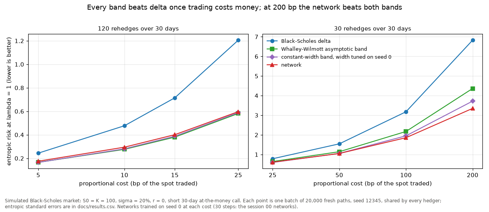

# deep-hedging

**With 50 bp trading costs, a trained hedger cuts entropic risk from 1.54 to 1.05 against
Black-Scholes delta, and loses 0.83 on average instead of 1.37 on a 2.29 premium (20,000
simulated paths). At 200 bp it beats the Whalley-Wilmott asymptotic band, 3.35 against
4.37 (delta 6.83).**

A neural network is trained end to end on simulated paths to minimise a convex risk
measure of the hedged P&L of a short call, as in Buehler, Gonon, Teichmann and Wood (2019),
and compared with delta hedging and with no-trade bands. The aim is deep hedging under
rough volatility; the markets so far are Black-Scholes and Heston.




## Results

Every number below is from `python -m deephedge.figures` (seed 12345, cached weights
trained on seed 0) and is written to [`docs/results.csv`](docs/results.csv). The short
call is 30-day at the money, S0 = K = 100, sigma = 20%, r = 0, rehedged daily.

**Session 00, proportional costs.** At 50 bp the network's mean P&L is -0.83 against
-1.37 for delta, and its entropic risk at lambda = 1 is 1.05 against 1.54. At 100 bp,
going from 10 to 120 rehedges takes delta's mean P&L from -1.96 to -4.48, close to the
square-root-of-n law; the network trained at 30 steps goes from -1.26 to -1.89, and its
standard deviation falls from 1.15 to 0.63, because inside its band it does not trade.

**Session 01, Heston, no cost** ([figure](docs/01_heston_pnl.png)). In the Heston market
of Buehler et al. (2019), section 5.2, with a variance swap as the second instrument, the
network matches the model hedge but does not beat it: premium plus CVaR at 50% is 2.00
against 1.99 (the paper prints 1.94). The model hedge has P&L standard deviation 0.40,
the network 0.44, and delta in the spot alone 1.56.

**Session 02, other cost models** ([figure](docs/02_cost_models.png)). Under a quadratic
impact of 0.02 the network's entropic risk is 0.94 against 2.46 for delta. Under a fixed
charge of 0.05 per trade it is worse than delta, 1.79 against 1.61 (see Limits).

**Session 03, against the Whalley-Wilmott band** ([figure](docs/03_risk_vs_cost.png)).
Entropic risk on the same 20,000 paths:

| Rehedges, cost | Delta | Whalley-Wilmott band | Constant band (tuned) | Network |
|---|---|---|---|---|
| 120, 5 bp | 0.244 | 0.166 | 0.165 | 0.175 |
| 30, 50 bp | 1.543 | 1.141 | 1.055 | 1.052 |
| 30, 200 bp | 6.828 | 4.365 | 3.721 | 3.350 |

Standard errors are 0.002 to 0.03 (in the CSV). The network's holdings track the
Whalley-Wilmott width across spot (correlation 0.998 at 30 steps and 50 bp), but a
constant-width band scores almost as high, so this does not show a gamma-shaped band.
At the money its cloud of holdings is 0.54 of the analytic half-width. Its width scales
like cost^0.293 at 120 steps (5 to 25 bp; bootstrap SE 0.007) against the analytic 1/3,
and like cost^0.063 at 30 steps (25 to 200 bp): discrete rehedging flattens it.

## What is in the repository

- `deephedge/env.py`, `markets.py`: the market environment (instruments, features,
  payoff, price, benchmark hedge, a pluggable cost) and the Black-Scholes simulator.
- `deephedge/heston.py`: Heston by full truncation Euler, a variance swap, the
  characteristic-function price and the model hedge.
- `deephedge/costs.py`: proportional, fixed-plus-proportional and quadratic costs.
- `deephedge/risk.py`: entropic risk and CVaR, in numpy and torch.
- `deephedge/policy.py`, `train.py`: the networks, rollouts, end-to-end training and the
  cached settings of each session.
- `deephedge/band.py`: the Whalley-Wilmott half-width, edge-trading bands and the
  summaries used in session 03.
- `deephedge/figures.py`: every PNG in `docs/` and `docs/results.csv`.
- `deephedge/export.py`: a compact JSON of paths, positions and P&L (provisional schema).
- `sessions/00` to `03`: marimo apps, with static copies in `docs/*.html`.
- `tests/`: checks against closed forms and known rates; `pytest --impl=exercises` runs
  them against from-scratch implementations in `exercises/`.

```python
from deephedge.env import BlackScholes, Environment, ProportionalCost

market = BlackScholes(s0=100, strike=100, maturity=30 / 365, sigma=0.2)
env = Environment(market, ProportionalCost(0.005))
paths = market.simulate(20_000, 30, seed=1)
pnl = env.pnl(paths, market.benchmark_positions(paths))
```

## Reproduce

With [uv](https://docs.astral.sh/uv/) and `make` (Python 3.11, torch on CPU, versions in
`uv.lock`):

```bash
make reproduce    # uv sync, tests, then every figure and docs/results.csv (about 1.5 minutes)
```

The interactive sessions: `uv run marimo run sessions/03_whalley_wilmott.py` (and 00 to
02). `uv run python -m deephedge.train` retrains the session 00 weights in `data/weights/`.

## Limits

- Simulated markets only: Black-Scholes and Heston, no market data.
- In Heston at zero cost the network does not beat the model hedge; the gap to the paper's
  1.94 is the coarse variance step of the simulation.
- Under a fixed charge the network loses to delta (1.79 against 1.61). It was trained on a
  smooth surrogate of the charge, never holds exactly still, and so pays the exact charge
  on almost every date.
- The learned band's cost exponent sits below the analytic 1/3 at discrete rehedging.
- One network per cost and per rehedging frequency, each trained on one seed.
- Rough Bergomi is not yet integrated; its simulator is in
  [rough-volatility](https://github.com/coreyjpritchard/rough-volatility).

The plan is in [ROADMAP.md](ROADMAP.md) and dated notes are in [LOG.md](LOG.md).

## References

- Buehler, Gonon, Teichmann, Wood (2019). Deep hedging. Quantitative Finance 19(8).
- Whalley, Wilmott (1997). An asymptotic analysis of an optimal hedging model for option
  pricing with transaction costs. Mathematical Finance 7(3).
- Horvath, Teichmann, Zuric (2021). Deep hedging under rough volatility. Risks 9(7).

MIT licence.

Built with the help of AI coding tools; all results are reproducible from the scripts in this repo.
